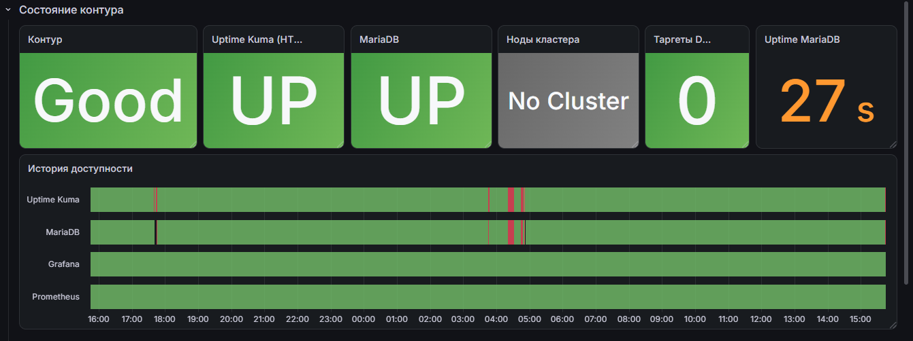
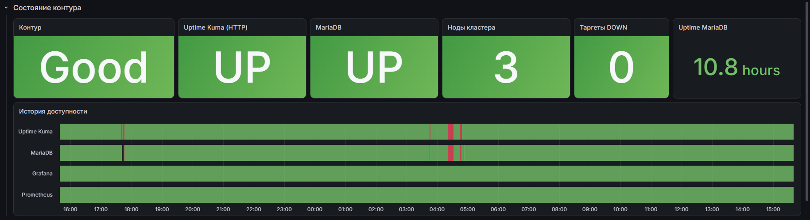
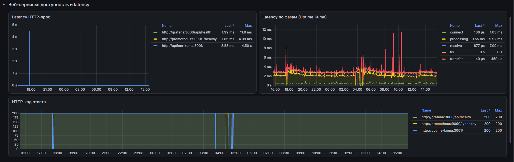
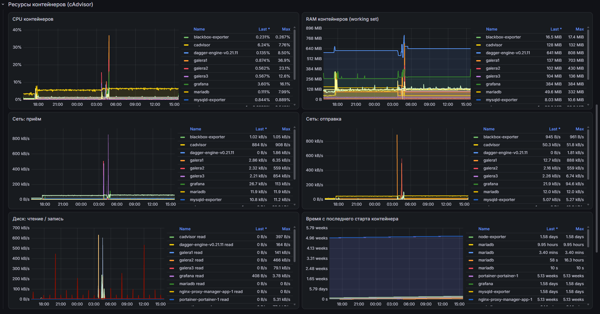
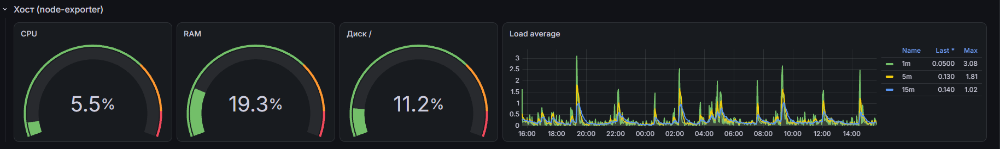
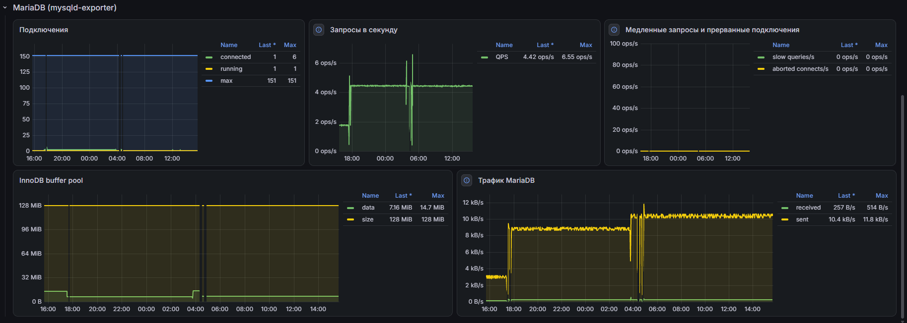
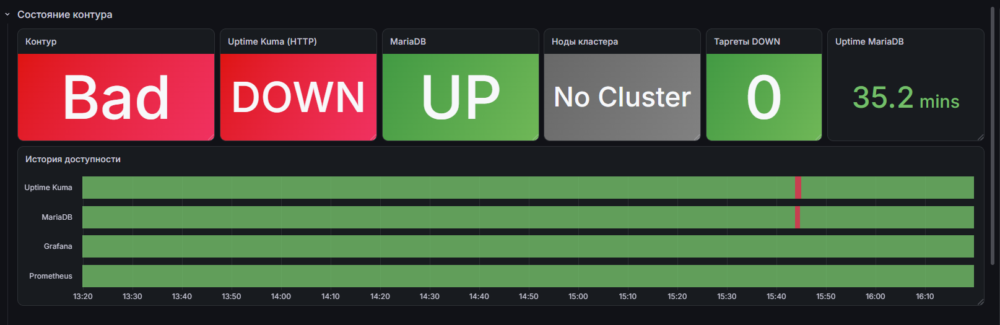
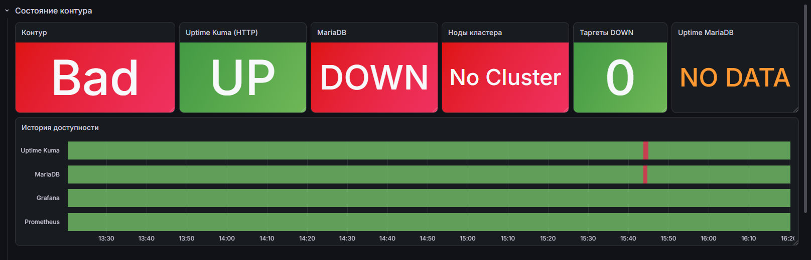
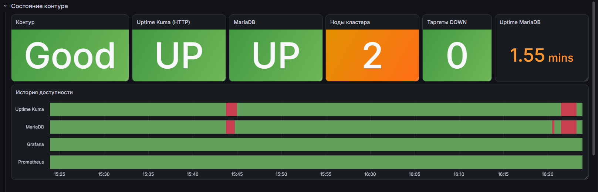

# Локальный контур мониторинга для Uptime Kuma

Стенд из двух независимых слоёв (docker compose), жизненным циклом и конфигурацией которых управляет [Dagger](https://docs.dagger.io/)-модуль на Go:

- **Слой 1 – приложение и БД:** [Uptime Kuma](https://github.com/louislam/uptime-kuma) + MariaDB (или Galera-кластер из 3 нод + HAProxy – бонус).
- **Слой 2 – наблюдаемость:** Prometheus, Grafana, mysqld-exporter, node-exporter, cAdvisor, blackbox-exporter.

---

## Быстрый старт

Файл `.env` с секретами приложен к архиву. Из папки проекта:

```bash
dagger call deploy-all --host-dir=$(pwd)
```

После запуска:

| Сервис | Адрес | Доступ |
|---|---|---|
| Uptime Kuma | http://localhost:3001 | при первом входе создать администратора |
| Grafana | http://localhost:3000 | `GF_ADMIN_USER` / `GF_ADMIN_PASSWORD` из `.env` |
| Дашборд | http://localhost:3000/d/kuma-health | |
| Prometheus | http://localhost:9090/targets | все таргеты должны быть **UP** |

Остановка:

```bash
docker compose -f monitoring/docker-compose.yaml down
docker compose -f app/docker-compose.yaml down      # или galera/docker-compose.yaml
```

Чтобы удалить и данные, добавьте `-v`. Общая сеть удаляется отдельно: `docker network rm monitoring`.

---

## Компоненты

Uptime Kuma работает с MariaDB вместо встроенной SQLite: подключение задаётся [переменными окружения](https://github.com/louislam/uptime-kuma/wiki/Environment-Variables) `UPTIME_KUMA_DB_*` (пример развёртывания: [Deploy Uptime Kuma](https://magnus919.com/notes/deploy-uptime-kuma/)).

Оба слоя подключены к общей внешней сети `monitoring`, поэтому Prometheus обращается к сервисам приложения по имени.

| Компонент | Что даёт |
|---|---|
| [**mysqld-exporter**](https://github.com/prometheus/mysqld_exporter) | статус БД (`mysql_up`), подключения, QPS, InnoDB, размер Galera-кластера |
| [**blackbox-exporter**](https://github.com/prometheus/blackbox_exporter) | доступность и latency веб-сервисов (HTTP-пробы Uptime Kuma, Grafana, Prometheus) |
| **cAdvisor** | CPU / RAM / сеть / диск контейнеров |
| **node-exporter** | ресурсы хоста |

### Структура репозитория

```
app/                              # Слой 1: MariaDB + Uptime Kuma
  docker-compose.yaml
  mariadb/init/01-exporter-user.sh  # пользователь для mysqld-exporter
galera/                           # Слой 1 (бонус): 3 ноды Galera + HAProxy + Uptime Kuma
  docker-compose.yaml
  galera.cnf                        # общие настройки Galera для всех нод
  haproxy.cfg
  bootstrap.sh                      # запуск galera1 (создание кластера)
  init/01-users.sh                  # пользователи для экспортера и SST
monitoring/                       # Слой 2: наблюдаемость
  docker-compose.yaml
  prometheus/prometheus.yaml
  blackbox/blackbox.yaml
  grafana/
    datasources/prometheus.json     # datasource для Grafana API
    dashboards/uptime-kuma-health.json
    configure-grafana.sh            # загрузка datasource и дашборда через API
dagger/                           # Dagger-модуль (Go)
  main.go                           # функции модуля
  go.mod, go.sum, dagger.gen.go, internal/  # сгенерировано Dagger
dagger.json                       # описание Dagger-модуля
chaos-test.sh                     # chaos-тест (бонус)
.env                              # секреты и аргументы Dagger по умолчанию
```

---

## Команды Dagger

| Команда | Что делает |
|---|---|
| `dagger call deploy-app --host-dir=$(pwd)` | поднимает MariaDB и Uptime Kuma, ждёт healthcheck (`--wait`) |
| `dagger call deploy-monitoring --host-dir=$(pwd)` | поднимает Prometheus, Grafana и экспортеры |
| `dagger call configure-grafana` | через [Grafana HTTP API](https://grafana.com/docs/grafana/latest/developers/http_api/) накатывает datasource и дашборд |
| `dagger call deploy-all --host-dir=$(pwd)` | **(бонус)** всё по очереди; падает, если какой-либо сервис не стал healthy |
| `... --galera` | **(бонус)** для `deploy-app` / `deploy-all`: Galera-кластер вместо одиночной MariaDB (см. [Galera Cluster](#бонус-galera-cluster)) |

Функции деплоя запускают `docker compose` в контейнере `docker:cli`, которому проброшен сокет Docker хоста (`/var/run/docker.sock`), по образцу модуля [docker-client](https://github.com/sipsma/daggerverse/blob/main/docker-client/main.go). Остальные аргументы (сокет, файл секретов, адрес Grafana) подставляются автоматически из `.env` через [local defaults](https://docs.dagger.io/features/local-defaults) Dagger, поэтому в командах их нет.

### Почему нужен `--host-dir=$(pwd)`

`docker compose` работает внутри контейнера Dagger, а контейнеры создаёт демон Docker на хосте. Относительные bind mount'ы (`./prometheus/prometheus.yaml`) compose превращает в абсолютные пути **внутри своего контейнера** и передаёт их демону хоста. Если пути не совпадают, демон не находит файл и молча создаёт на хосте пустую папку – Prometheus падает с `is a directory`.

Поэтому проект монтируется в контейнер Dagger по тому же пути, что и на хосте. Dagger не умеет сам узнать текущую папку хоста, а подставить `${PWD}` прямо в `.env` нельзя – переменные там не раскрываются. Поэтому путь передаётся аргументом, его раскрывает оболочка.

---

## Проверка работоспособности

1. `docker ps` – все контейнеры `Up`, у `mariadb` и `uptime-kuma` статус `(healthy)`.
2. http://localhost:9090/targets – все job'ы в статусе **UP**.
3. Дашборд «Uptime Kuma – здоровье контура»: плитка **Контур = Good**.

### Дашборд

**Состояние контура** – итоговый статус (**Good** / **Bad**: БД и Uptime Kuma доступны), статусы сервисов, ноды кластера, недоступные таргеты, uptime БД и история доступности.

Одиночная MariaDB (обычный режим) – панель «Ноды кластера» показывает «No Cluster»:



Режим Galera – в кластере 3 ноды:



**Веб-сервисы** – latency HTTP-проб, latency Uptime Kuma по фазам запроса, HTTP-коды ответов.



**Ресурсы контейнеров** – CPU, RAM, сеть, диск и время с последнего старта (по нему видны рестарты).



**Хост** – CPU, RAM, диск, load average.



**MariaDB** – подключения, запросы в секунду, медленные запросы, InnoDB buffer pool, трафик.



---

## Бонус: Chaos Testing

```bash
./chaos-test.sh uptime-kuma
./chaos-test.sh mariadb
./chaos-test.sh galera2      # в режиме Galera
```

Скрипт **не использует `docker stop`**: Docker считает ручную остановку намеренной и [restart-policy](https://docs.docker.com/engine/containers/start-containers-automatically/) к ней не применяет – контейнер не поднимется сам. Вместо этого скрипт завершает главный процесс внутри контейнера (`kill`). Для Docker это падение приложения, и контейнер перезапускается по `restart: unless-stopped`. Скрипт ждёт, пока контейнер снова станет `healthy`; сам он контейнер не запускает.

Результат на дашборде:

- **(а)** плитка **Контур** переходит в **Bad**, на «Истории доступности» появляется красный участок;
- **(б)** после восстановления – снова **Good**, на панели «Время с последнего старта контейнера» виден рестарт.

На скриншотах «Состояние контура» выше видны красные участки на «Истории доступности» – это прогоны chaos-теста, после каждого сервисы вернулись в норму.

Prometheus опрашивает сервисы раз в 5 секунд, поэтому если контейнер успевает перезапуститься быстрее (так бывает с Uptime Kuma), плитка статуса может не покраснеть – рестарт всё равно виден на панели «Время с последнего старта контейнера».

Падение Uptime Kuma (`./chaos-test.sh uptime-kuma`):



Падение MariaDB (`./chaos-test.sh mariadb`):



---

## Бонус: Galera Cluster

```
uptime-kuma ──┐
              ├──► mariadb (HAProxy) ──► galera1 / galera2 / galera3
mysqld-exp ───┘                          (синхронная репликация)
```

- Три ноды MariaDB с включённой Galera, у каждой свой том. Общие настройки нод вынесены в `galera.cnf` и [extension-блок](https://docs.docker.com/reference/compose-file/extension/) `x-galera-node` в compose. Набор параметров Galera сверялся с примером [galera-docker-cluster](https://github.com/lhansey/galera-docker-cluster).
- Используется официальный образ `mariadb`: Galera и `mariabackup` для копирования данных между нодами (SST) в нём уже есть. Healthcheck проверяет, что нода синхронизирована с кластером (`--galera_online` из [healthcheck.sh](https://github.com/MariaDB/mariadb-docker) образа). Ноды запускаются по очереди (`depends_on: service_healthy`).
- Контейнер **HAProxy называется `mariadb`** – Uptime Kuma, mysqld-exporter и дашборд работают без изменений, теперь через балансировщик.
- `balance first`: запись идёт в одну ноду, остальные – горячий резерв (исключает конфликты записи между нодами).
- `galera/bootstrap.sh` запускает `galera1` с `--wsrep-new-cluster` только при первом старте или если Galera пометила её как безопасную для старта (`safe_to_bootstrap: 1`) – иначе нода присоединяется к работающему кластеру.

Если все три ноды упадут аварийно, кластер сам не поднимется – нужно вручную запустить самую свежую ноду с bootstrap. Это стандартное поведение [Galera](https://mariadb.com/kb/en/galera-cluster/).

### Переключение между одиночной MariaDB и Galera

Оба варианта используют одинаковые имена контейнеров (`mariadb`, `uptime-kuma`), поэтому **перед переключением старый вариант нужно остановить**:

```bash
# одиночная MariaDB → Galera
docker compose -f app/docker-compose.yaml down
dagger call deploy-all --host-dir=$(pwd) --galera

# Galera → одиночная MariaDB
docker compose -f galera/docker-compose.yaml down
dagger call deploy-all --host-dir=$(pwd)
```

`down` без `-v` удаляет только контейнеры – данные обоих вариантов сохраняются в своих томах. У каждого варианта своя база, поэтому администратора Uptime Kuma при первом переключении нужно создать заново.

### Проверка

Панель **«Ноды кластера»**: 3 – норма, 2 – кластер деградировал, но работает, «No Cluster» – запущена одиночная MariaDB (скриншоты обоих режимов – в разделе [Дашборд](#дашборд)).

Падение ноды: `./chaos-test.sh galera2` – «Ноды кластера» 3 → 2 → 3, **Контур остаётся Good**.



---

## Секреты

- Все секреты – только в `.env` (в `.gitignore`, в git не попадает); для проверки он приложен к архиву.
- В Dagger `.env` передаётся как `Secret` (`file://.env`): не попадает в кэш и логи. Из папки проекта, которую получает Dagger, `.env` исключён (`+ignore`).
- Root, приложение, экспортер и Grafana – разные пароли. mysqld-exporter работает под отдельным пользователем только с правами на чтение служебной информации (`PROCESS, REPLICATION CLIENT, SELECT`).
- Galera: копирование данных между нодами (SST) идёт через unix-сокет, пароль в конфиге не хранится.
- Для прода: `*_FILE`-переменные / Docker secrets или хранилище секретов (Vault и т.п.).

---

## Решения и компромиссы

- **Доступность Uptime Kuma – через blackbox-exporter, а не `/metrics` самой Kuma.** [Интеграция с Prometheus](https://github.com/louislam/uptime-kuma/wiki/Prometheus-Integration) требует [API-ключа](https://github.com/louislam/uptime-kuma/wiki/Prometheus-API-Keys), который создаётся вручную в интерфейсе, – это ломает автоматический запуск. К тому же Kuma – объект мониторинга: если она упадёт, метрики о её доступности пропадут вместе с ней.
- **Grafana без тома.** Datasource и дашборд накатываются через API командой `configure-grafana` – конфигурация хранится как код и восстанавливается одной командой.
- **Статусные плитки – instant-запросы.** Иначе Stat-панель показывает последнее известное значение, а не текущее (например, «3 ноды» при остановленном кластере).
- **Кэш Dagger.** Функции помечены `+cache="never"`, а внутри добавлен `CACHE_BUSTER`: директива отключает кэш вызова функции, но не отдельных `WithExec` внутри неё.
- **cAdvisor из `ghcr.io/google/cadvisor`.** Старый образ `gcr.io/cadvisor/cadvisor` (v0.49) не работает с API Docker 29+ ([issue #3749](https://github.com/google/cadvisor/issues/3749)).
- **Официальный образ `mariadb`, а не Bitnami.** Бесплатные образы Bitnami больше не обновляются; Galera уже есть в официальном образе.

---

## Работа с AI

Какие AI-инструменты использовались и где они ошибались – в [AI_REVIEW.md](AI_REVIEW.md).

---

## Источники

**Uptime Kuma:** [репозиторий](https://github.com/louislam/uptime-kuma) · [переменные окружения](https://github.com/louislam/uptime-kuma/wiki/Environment-Variables) · [интеграция с Prometheus](https://github.com/louislam/uptime-kuma/wiki/Prometheus-Integration) · [API-ключи](https://github.com/louislam/uptime-kuma/wiki/Prometheus-API-Keys) · [Deploy Uptime Kuma](https://magnus919.com/notes/deploy-uptime-kuma/)

**Dagger:** [документация](https://docs.dagger.io/) · [local defaults](https://docs.dagger.io/features/local-defaults) · [docker-client (пример работы с сокетом)](https://github.com/sipsma/daggerverse/blob/main/docker-client/main.go)

**Docker:** [restart policies](https://docs.docker.com/engine/containers/start-containers-automatically/) · [extension-блоки compose](https://docs.docker.com/reference/compose-file/extension/)

**Мониторинг:** [mysqld_exporter](https://github.com/prometheus/mysqld_exporter) · [blackbox_exporter](https://github.com/prometheus/blackbox_exporter) · [cAdvisor issue #3749](https://github.com/google/cadvisor/issues/3749) · [Grafana HTTP API](https://grafana.com/docs/grafana/latest/developers/http_api/)

**MariaDB / Galera:** [официальный образ](https://github.com/MariaDB/mariadb-docker) · [Galera Cluster](https://mariadb.com/kb/en/galera-cluster/) · [galera-docker-cluster](https://github.com/lhansey/galera-docker-cluster)
